# Workflow map

Snapshot of `.claude/` (rules, skills, hooks). The rules and skills are the source of truth; this file is a picture of them.

Legend: diamond = decision, `GD` = the main GD decides, `[agent]` = who does the step.

## 1. Project lifecycle

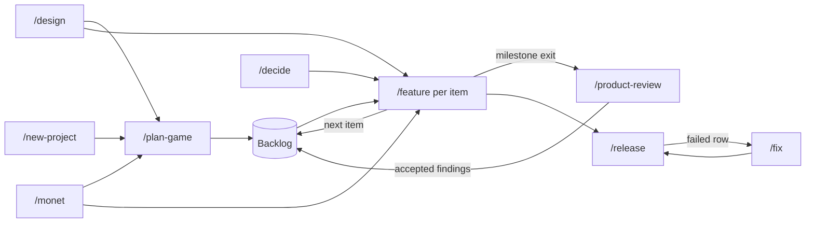

## 2. Input routing (first match wins)

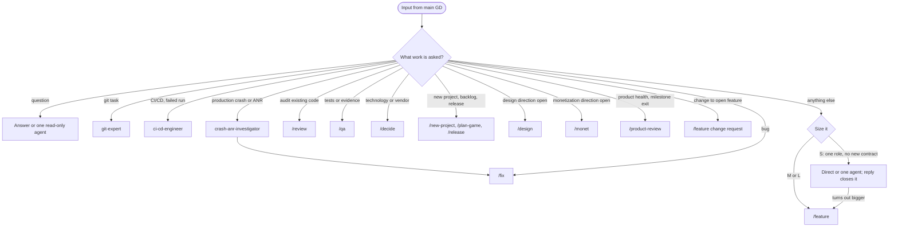

## 3. /feature

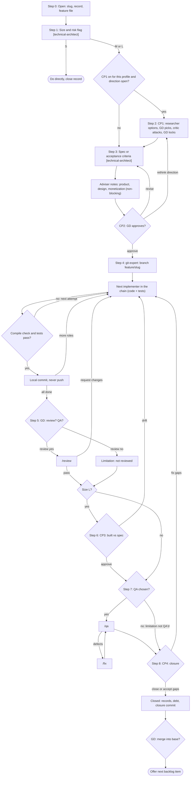

Implementer chain (unused roles are skipped; `sdk-platform-engineer` takes any slot):

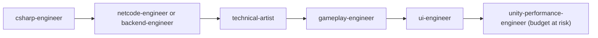

Lanes build mode (only when chosen at CP2):

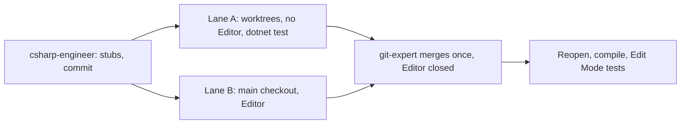

## 4. /fix

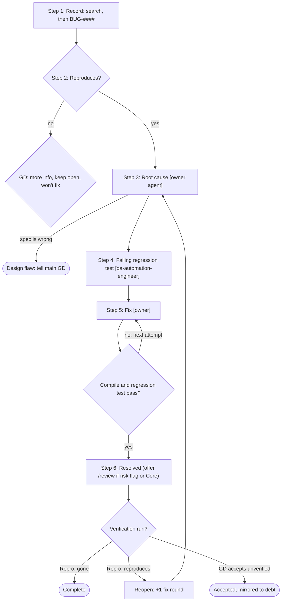

## 5. /review and /qa

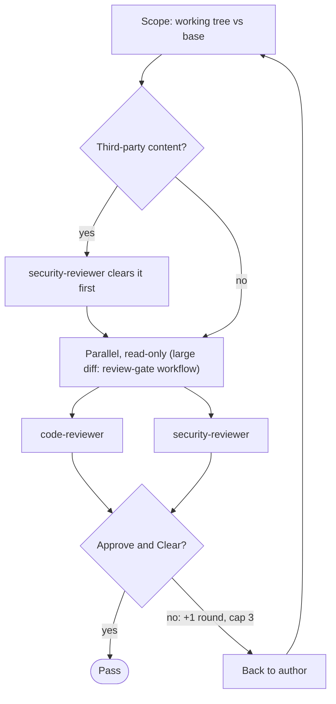

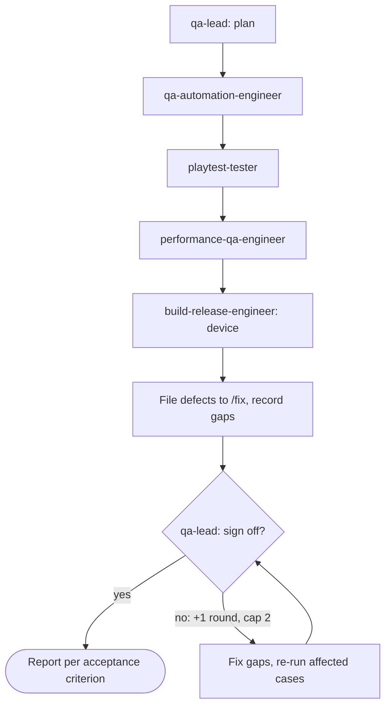

Only the agents named in the plan run, one at a time.

## 6. Direction workflows

### /design

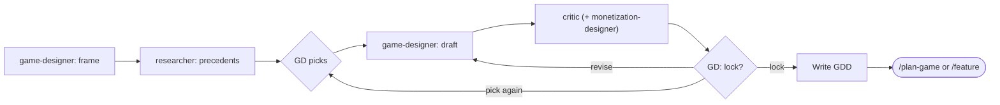

### /monet

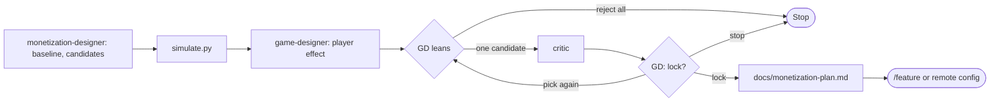

### /decide

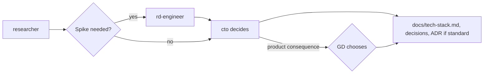

### /product-review

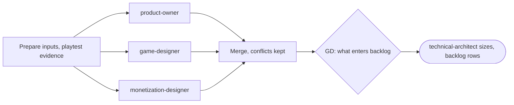

## 7. /plan-game and /new-project

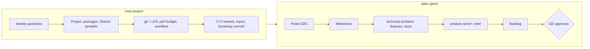

## 8. /release

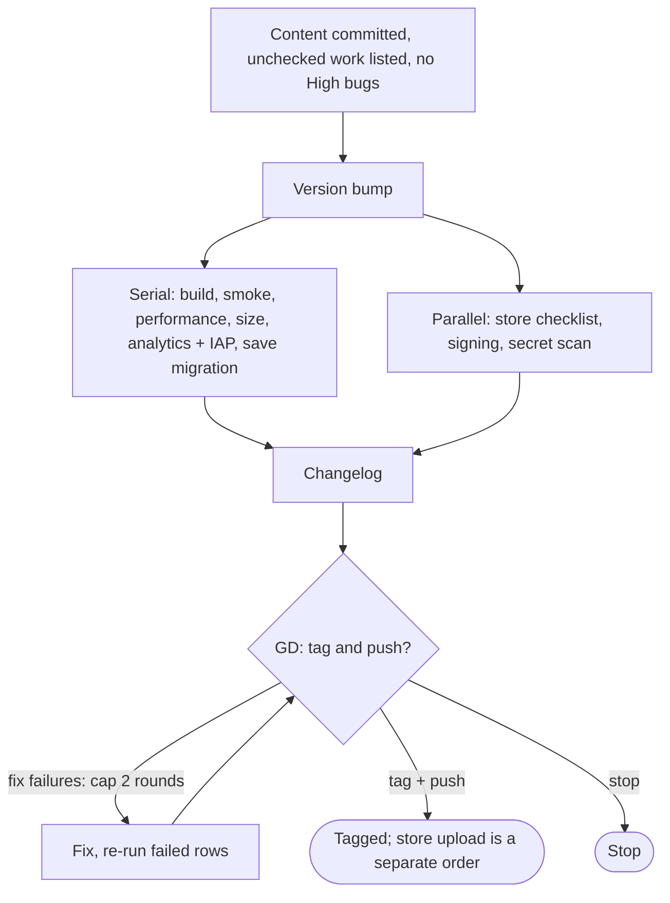

## 9. Stop rule

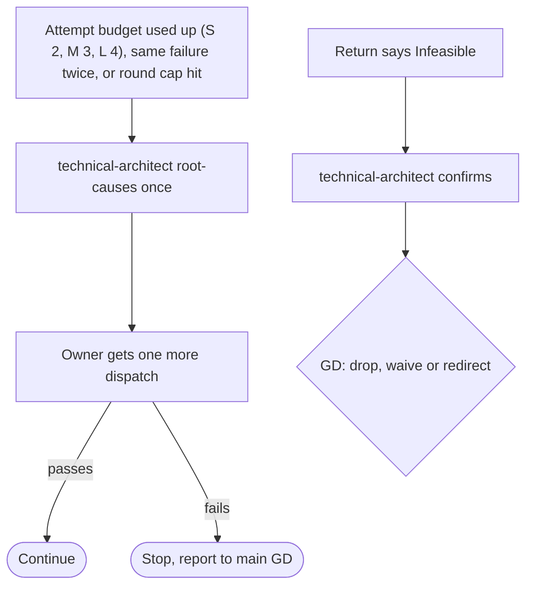

Round caps: review 3 · QA sign-off 2 · bug fix 2 · bug review 3 · feature rework M 6, L 8.

## 10. Hooks (run automatically)

```mermaid
flowchart LR
    subgraph START["SessionStart"]
        H1["session-start: memory, bugs, records"]
    end
    subgraph PRE["Before a tool call"]
        H2["secret-scan: file edits"]
        H3["editor-lock: Editor, Unity, project folders"]
        H4["pre-commit, pre-push, git-guard"]
        H5["search-guard: prefer XERJ"]
        H6["round-cap: Agent and Workflow dispatch"]
        H7["log-triage-scan: handback"]
    end
    subgraph POST["After a tool call"]
        H8["verify-on-edit: .claude changes"]
        H9["package-changed: supply-chain reminder"]
        H10["round-cap: records and bug edits"]
    end
    subgraph END_["Agent or session end"]
        H11["SubagentStop: lock release, round count, advisory capture, log-triage scan"]
        H12["Stop, SessionEnd: lock clear, memory capture"]
    end
    START --> PRE --> POST --> END_
```
